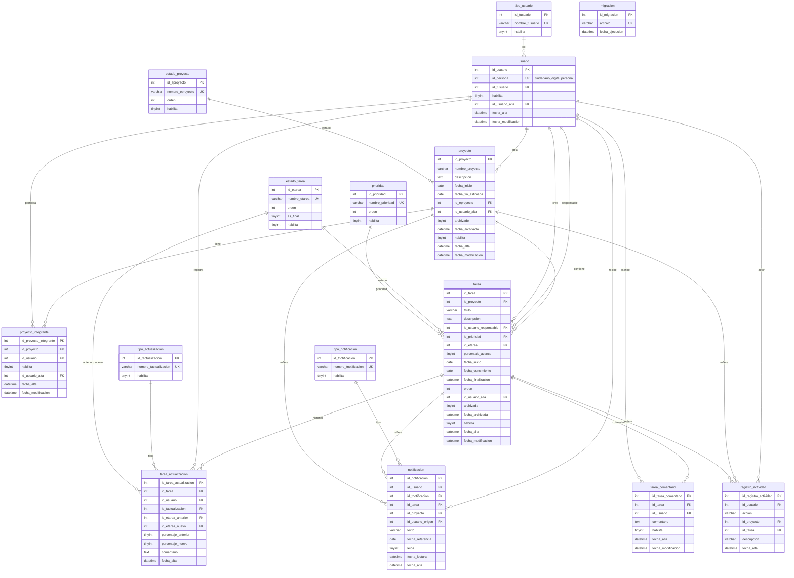

# Base de datos `organizador_smt`

MySQL / MariaDB, InnoDB, `utf8mb4`. El esquema está versionado en [`back/migrations`](../back/migrations) y se aplica con `npm run migrar`.

Sigue las convenciones del resto de las bases de DITEC:

- tablas en español, singular y `snake_case`;
- clave primaria `id_<tabla>`; los catálogos usan clave abreviada (`id_tusuario`, `id_etarea`, `id_eproyecto`…);
- borrado lógico con `habilita` (1/0): nunca se borran filas;
- `fecha_alta` y `fecha_modificacion` en las tablas que se editan.

## Diagrama entidad-relación



## Tablas

### Catálogos

Tienen ids fijos porque el código los usa como constantes ([`back/utils/constantes.js`](../back/utils/constantes.js)). Los valores se cargan en la migración `002`.

| Tabla | Valores iniciales | Notas |
|---|---|---|
| `tipo_usuario` | 1 ADMINISTRADOR, 2 SUPERVISOR, 3 COLABORADOR | Es la tabla de roles. |
| `estado_proyecto` | 1 Planificación, 2 Activo, 3 Pausado, 4 Finalizado | `orden` define cómo se listan. |
| `estado_tarea` | 1 Pendiente, 2 En progreso, 3 En revisión, 4 Bloqueada, 5 Finalizada | `orden` es el orden de las columnas del tablero. `es_final = 1` marca que la tarea está terminada. |
| `prioridad` | 1 Baja, 2 Media, 3 Alta, 4 Urgente | `orden`: mayor es más urgente. |
| `tipo_actualizacion` | 1 Avance, 2 Novedad, 3 Dificultad o bloqueo, 4 Cambio de estado | El 4 lo registra el tablero al mover una tarjeta. |
| `tipo_notificacion` | 1 Tarea asignada, 2 Tarea modificada, 3 Nuevo comentario, 4 Próxima a vencer, 5 Cambio de fecha de entrega, 6 Avance registrado | |

### `usuario`

Quién puede entrar al Organizador y con qué rol. No guarda nombre, email ni contraseña: eso vive en `ciudadano_digital.persona`.

| Columna | Tipo | Obligatorio | Descripción |
|---|---|---|---|
| `id_usuario` | INT, PK | sí | |
| `id_persona` | INT, único | sí | Persona de Ciudad Digital. Sin `FOREIGN KEY` porque está en otra base. |
| `id_tusuario` | INT, FK | sí | Rol. |
| `habilita` | TINYINT(1) | sí | 0 = no puede entrar. |
| `id_usuario_alta` | INT, FK | no | Quién lo dio de alta. `NULL` en el alta inicial por script. |
| `fecha_alta`, `fecha_modificacion` | DATETIME | | |

### `proyecto`

| Columna | Tipo | Obligatorio | Descripción |
|---|---|---|---|
| `id_proyecto` | INT, PK | sí | |
| `nombre_proyecto` | VARCHAR(150) | sí | |
| `descripcion` | TEXT | no | |
| `fecha_inicio`, `fecha_fin_estimada` | DATE | no | `CHECK`: el fin no puede ser anterior al inicio. |
| `id_eproyecto` | INT, FK | sí | Estado. |
| `id_usuario_alta` | INT, FK | sí | Quién lo creó. |
| `archivado`, `fecha_archivado` | TINYINT(1), DATETIME | | Un proyecto archivado queda solo de consulta. |
| `habilita` | TINYINT(1) | sí | Borrado lógico. |
| `fecha_alta`, `fecha_modificacion` | DATETIME | | |

### `proyecto_integrante`

Relación muchos a muchos entre `proyecto` y `usuario`. Ser integrante es lo que da acceso al proyecto. Clave única `(id_proyecto, id_usuario)`: si a alguien se lo quita y se lo vuelve a sumar, se reutiliza la misma fila (`habilita`).

### `tarea`

| Columna | Tipo | Obligatorio | Descripción |
|---|---|---|---|
| `id_tarea` | INT, PK | sí | |
| `id_proyecto` | INT, FK | sí | |
| `titulo` | VARCHAR(200) | sí | |
| `descripcion` | TEXT | no | |
| `id_usuario_responsable` | INT, FK | no | Responsable principal. `NULL` = sin asignar. |
| `id_prioridad` | INT, FK | sí | |
| `id_etarea` | INT, FK | sí | Estado. |
| `porcentaje_avance` | TINYINT UNSIGNED | sí | 0 a 100 (`CHECK`). |
| `fecha_inicio`, `fecha_vencimiento` | DATE | no | |
| `fecha_finalizacion` | DATETIME | no | Se completa sola al pasar a un estado final y se limpia al salir. |
| `orden` | INT | sí | Posición de la tarjeta en su columna del tablero. |
| `id_usuario_alta` | INT, FK | sí | Quién la creó. |
| `archivada`, `fecha_archivada` | TINYINT(1), DATETIME | | |
| `habilita` | TINYINT(1) | sí | Borrado lógico. |
| `fecha_alta`, `fecha_modificacion` | DATETIME | | `fecha_alta` es la fecha de creación. |

### `tarea_actualizacion`

Historial de seguimiento. **Solo se insertan filas**: nunca se editan ni se borran. Cada fila dice quién, cuándo, de qué tipo fue la actualización y, si cambiaron, el estado anterior y nuevo y el porcentaje anterior y nuevo. Los cuatro campos de "anterior / nuevo" quedan en `NULL` cuando ese dato no cambió.

### `tarea_comentario`

Conversación de la tarea. `habilita = 0` cuando su autor (o un administrador) lo elimina.

### `notificacion`

Una fila por destinatario. `id_usuario_origen` es quién la provocó (`NULL` = el sistema). `fecha_referencia` guarda el vencimiento que se avisó, para no repetir el aviso de "próxima a vencer" salvo que la fecha cambie.

### `registro_actividad`

Bitácora general, solo inserciones. Alimenta la "actividad reciente" del panel y la pestaña Actividad de cada proyecto. `accion` es un código (`TAREA_CREADA`, `PROYECTO_EDITADO`…) y `descripcion` el texto listo para mostrar después del nombre de quien lo hizo.

### `migracion`

La crea y mantiene el runner: anota qué archivos de `back/migrations` ya se aplicaron.

## Relaciones

| Relación | Tipo | Cómo se resuelve |
|---|---|---|
| `usuario` – persona de Ciudad Digital | uno a uno | `usuario.id_persona` único. |
| `tipo_usuario` – `usuario` | uno a muchos | `usuario.id_tusuario`. Cada usuario tiene un solo rol. |
| `proyecto` – `usuario` (integrantes) | muchos a muchos | Tabla `proyecto_integrante`. |
| `proyecto` – `tarea` | uno a muchos | `tarea.id_proyecto`. |
| `usuario` – `tarea` (responsable) | uno a muchos | `tarea.id_usuario_responsable`, opcional. |
| `tarea` – `tarea_actualizacion` / `tarea_comentario` | uno a muchos | `id_tarea`. |
| `usuario` – `notificacion` | uno a muchos | `notificacion.id_usuario` (destinatario). |

Todas las claves foráneas son `RESTRICT` (el valor por defecto): como nada se borra físicamente, no hay cascadas.

## Índices

Además de las claves primarias y únicas:

| Índice | Para qué |
|---|---|
| `tarea (id_proyecto, archivada, id_etarea)` | Tablero y lista de un proyecto. |
| `tarea (id_usuario_responsable, archivada, id_etarea)` | "Mis tareas" y el panel del colaborador. |
| `tarea (fecha_vencimiento)` | Vencidas, próximas a vencer y el aviso automático. |
| `tarea (id_etarea, orden)` | Orden de las tarjetas en cada columna. |
| `proyecto_integrante (id_usuario, habilita)` | Qué proyectos ve un usuario (se consulta en casi todos los pedidos). |
| `proyecto (id_eproyecto, archivado)` y `(nombre_proyecto)` | Filtros y búsqueda de proyectos. |
| `tarea_actualizacion (id_tarea, fecha_alta)` | Historial de una tarea. |
| `notificacion (id_usuario, leida, fecha_alta)` | Campana y lista de notificaciones. |
| `notificacion (id_tarea, id_usuario, id_tnotificacion, fecha_referencia)` | Evitar avisos de vencimiento repetidos. |
| `registro_actividad (fecha_alta)`, `(id_proyecto, fecha_alta)`, `(id_tarea, fecha_alta)` | Actividad reciente. |

## Decisiones de modelado

1. **Las personas no se duplican.** El login es el de Ciudad Digital, así que `usuario` solo une `id_persona` con un rol. El nombre se obtiene con un `JOIN` a `ciudadano_digital.persona`, igual que en Movilidad. Consecuencia: `organizador_smt` tiene que estar en el mismo servidor MySQL que `ciudadano_digital`, y el usuario de la base necesita `SELECT` sobre `persona`.
2. **Catálogos en tablas, no `ENUM`.** Es como están hechas las otras bases, permite sumar un estado o una prioridad con un `INSERT` y deja el nombre para mostrar en un solo lugar.
3. **Actualizaciones y comentarios en tablas separadas.** Una actualización es un registro de avance (inmutable, con estado y porcentaje); un comentario es conversación (se puede eliminar). Mezclarlos obligaría a llenar de `NULL` una sola tabla.
4. **El historial guarda el valor anterior y el nuevo.** Así cada fila se entiende sola, sin reconstruir el estado recorriendo las anteriores.
5. **`registro_actividad` aparte del historial de la tarea.** El historial es de una tarea; la bitácora cubre también proyectos, integrantes y usuarios, y es lo que se muestra como actividad del equipo.
6. **Acceso por integrante.** No hay una tabla de permisos por proyecto: quien es integrante lo ve y, si su rol es supervisor, lo gestiona. Quien crea un proyecto queda como integrante.
7. **Archivar no es borrar.** `archivado` / `archivada` sacan el proyecto o la tarea del trabajo diario pero siguen consultables; `habilita` es el borrado lógico.
8. **`orden` único en toda la tabla `tarea`.** Reordenar una columna solo permuta valores que ya existen, así nunca choca con tarjetas que el usuario no ve por sus filtros o permisos.
9. **Un responsable por tarea.** Es lo que se pidió para esta versión. Si más adelante hacen falta varios, se agrega una tabla `tarea_responsable` sin tocar el resto.

## Migraciones

- Cada archivo se llama `AAAA-MM-DD_NNN_descripcion.sql` y empieza con un comentario que dice qué hace y en qué base se ejecuta.
- `npm run migrar` aplica los pendientes en orden y los anota en `migracion`. `npm run migrar:estado` solo los lista.
- Un archivo ya aplicado no se edita: los cambios van en un archivo nuevo.
- MySQL confirma cada `CREATE` / `ALTER` por separado, así que una migración que falla a la mitad no se revierte sola: el runner corta en el primer error y no la anota.

## Datos iniciales y usuarios de prueba

La migración `002` carga los catálogos. Los usuarios no van en un script SQL porque dependen de personas reales de Ciudad Digital; se dan de alta con:

```bash
npm run usuario:crear -- <CUIL> ADMINISTRADOR
```

El primer administrador se crea así; el resto se puede cargar desde la pantalla Usuarios.
